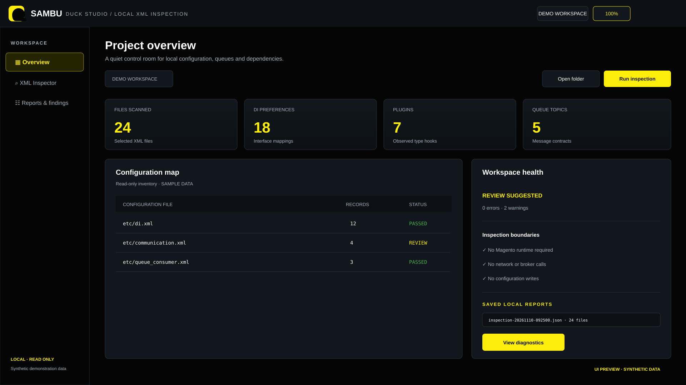
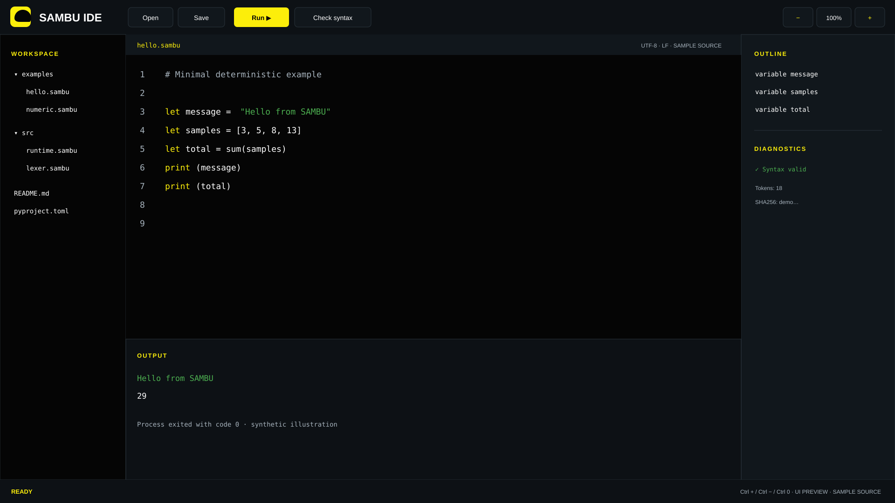

  

<h1 align="center">SAMBU</h1>

<strong>Scientific Modeling &amp; Automation Environment</strong>

  
  
  

  <a href="README.md">🇺🇦 Українська</a> ·
  <a href="README.en.md">🇬🇧 English</a> ·
  <a href="README.ru.md">🇷🇺 Русский</a>

**One experimental environment for programming, scientific models, spatial data, and reproducible workflows.** SAMBU combines an interpreted language core, Python tooling, and a separate early native-compiler track.

## Why SAMBU

SAMBU is for engineers and researchers who need readable models, controlled computation, and inspectable tools. Its goal is to bring language features, scientific domains, and workflows into one coherent environment without hiding implementation boundaries.

## Capabilities

- **Language core:** lexer/parser, AST source spans, functions, scopes, arrays, records, classes, and bounded loops.
- **Scientific computing:** SI quantities, dimensional checks, physical constants, statistical mechanics, and reproducible sampling.
- **Spatial models:** sparse voxel grids, chunks, Morton keys, octrees, surface geometry, and graph operations.
- **Workflow and tools:** CLI, Tkinter IDE, test runner, architecture checks, and workflow models.
- **Text metadata:** deterministic analysis of structure, repetition, approximate prosody, and semantic markers. This is data analysis, not text generation or artistic-quality scoring.
- **Native compiler slice:** an isolated C11 track with typed HIR/MIR/LIR and IR verification; it is not a complete native compiler.

## Quick start

Python 3.10+ and Git are required. The interpreter has no mandatory third-party runtime dependencies.

~~~bash
git clone https://github.com/bboroski/SAMBU.git
cd SAMBU
python -m pip install -e .
sambu --version
~~~

Run a program:

~~~bash
sambu examples/ideal_gas.sambu
sambu -c 'print("Hello from SAMBU")'
~~~

Run checks and the one-knob entry point:

~~~bash
python -m pytest
python one.py check
~~~

On Windows, the <code>one.cmd</code> script is also available. <code>python one.py</code> runs the project's standard workflow.

## Developer experience

The IDE currently provides file editing, execution, output, and basic diagnostics. It is a useful working interface, but not yet a full LSP IDE.

  
  

## Project management and readiness

| Gate | Current policy |
|---|---|
| Maturity | Experimental alpha; APIs and capabilities may change |
| Verification | pytest, CLI smoke tests, and architecture checks |
| Native path | Separate experimental slice; does not replace the Python interpreter |
| Integrations | An adapter or profile does not imply a completed production integration |
| API changes | Compatibility paths remain until a separately documented migration |

## Architecture and limits

SAMBU is a Python-hosted alpha project. Flask, Django, and FastAPI extensions are optional. The native compiler path does not yet include a complete source-parser bridge, CFG/phi-node support, an optimization pipeline, an object writer, or machine-code generation. A complete static type/effect system and LSP remain development directions.

Documentation:
- [Articulatory grammar](docs/ARTICULATORY_SYNTAX.md)
- [Ecosystem architecture](docs/ECOSYSTEM_ARCHITECTURE.md)
- [Multilingual signal pipeline](docs/MULTILINGUAL_SIGNAL_PIPELINE.md)
- [SAMBU encyclopedia](wiki/README.md)

## Ecosystem

SAMBU is the language and modeling layer in the family: [ToolNG](https://github.com/bboroski/ToolNG) · [ReaperCripple](https://github.com/bboroski/ReaperCripple) · [Kloz](https://github.com/bboroski/Kloz) · [CO](https://github.com/bboroski/CO) · [SaintSI](https://github.com/bboroski/SaintSI) · [Klipot](https://github.com/bboroski/Klipot) · [NUN](https://github.com/bboroski/NUN) · [NUNLauncher](https://github.com/bboroski/NUNLauncher).

## Naming and compatibility

**SAMBU** is the canonical environment name and CLI alias. Historical distribution, Python package, and .sambu extension names remain for compatibility; replacing them requires a separate API migration.

## License

MIT — see [LICENSE](LICENSE).

## Academic biology glossary

- [500 academic terms EN–RU](data/biology/academic_terms_500.tsv)
- [Data contract and usage boundaries](docs/BIOLOGY_DOMAIN_PACK.md)

An offline reference pack for education and metadata; it does not control systems, devices or diagnostics.

## NUN Mesh

NUN Mesh maps SAMBU to the independent ecosystem through explicit capability contracts and versioned adapters. The diagram is static documentation and does not imply a shared runtime.
