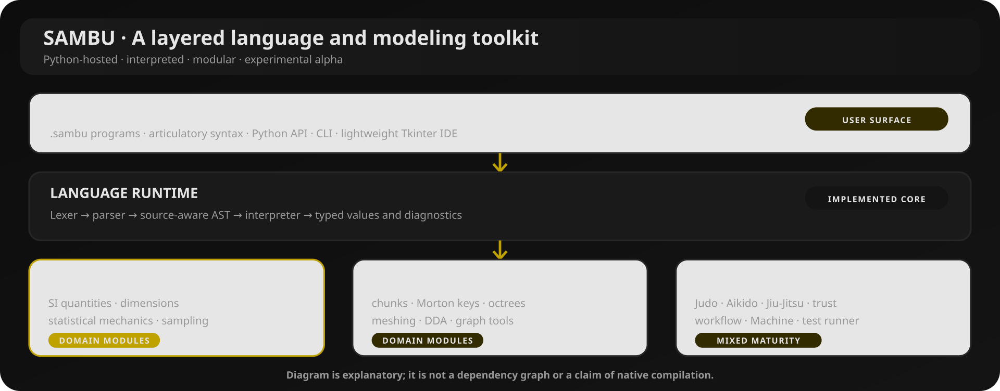
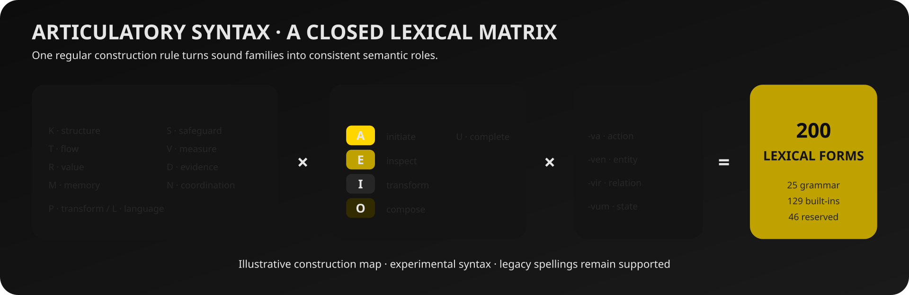
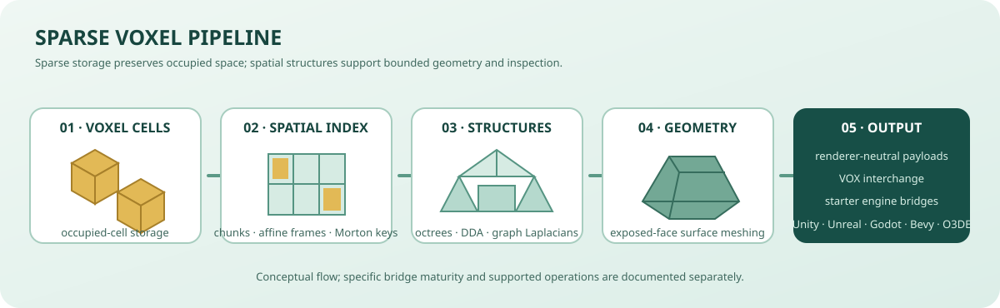
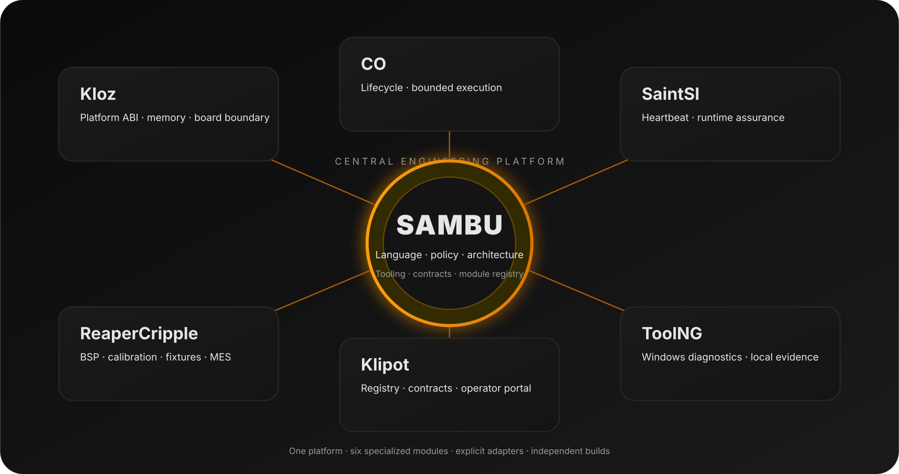

# SAMBU

### Statistical Analysis · Modeling · Systems · Trust

**Невелика мова з широким горизонтом.**

Експериментальна інтерпретована мова та Python-інструментарій для наукових обчислень, моделювання, системної архітектури, workflow та розріджених voxel-світів.

[Українська](README.md) · [English](README.en.md) · [Русский](README.ru.md)

[Швидкий старт](#-швидкий-старт) · [Мова](#-мова-sambu) · [Можливості](#-карта-можливостей) · [Інструменти](#-інструменти) · [Документація](#-документація)

---

> **Стадія зрілості: експериментальна alpha.** Інтерпретатор, вибрані предметні модулі та CLI-інструменти реалізовані й тестуються. Нативний компілятор, повна статична система типів та ефектів, повноцінна LSP-IDE й частина інтеграцій залишаються напрямами розвитку.

## Що таке SAMBU

SAMBU поєднує мову для програм <code>.sambu</code> з Python-пакетом для наукових, архітектурних і workflow-завдань. Основні принципи: явні припущення, обмежені операції, перевірювані результати та модульна еволюція.

## Карта можливостей

| Напрям | Реалізовані можливості |
|---|---|
| **Мовне ядро** | Lexer/parser, незмінний AST із source spans, області видимості, функції, обмежені цикли, масиви, записи, класи та наслідування. |
| **Наукові обчислення** | SI-величини, перевірка розмірностей, фізичні константи, теплова енергія, швидкості Максвелла, фактори Больцмана, статистичні суми, ентропія та відтворюване семплювання. |
| **Sparse voxel** | Обмежені чанки, афінні системи координат, Morton keys, побудова поверхонь, 3D DDA, sparse octrees, графові лапласіани та VOX interchange. |
| **Інженерні модулі** | Judo — архітектурні графи; Aikido — маршрутизація inference; Jiu-Jitsu — UI/MVC/RBAC-моделі; workflow, trust-перевірки та оборотні патчі. |
| **Runtime-експерименти** | Обмежені actor-mailbox, послідовна фіксація стану, dead-letter записи, supervision і типізовані програмні канали. Це не нативне паралельне виконання. |
| **Інструменти** | CLI sambu, read-only аналізатор Magento XML sambu-studio, Tkinter IDE sambu-ide, sambu-test і SAMBU Machine. |
| **Аналіз творчого тексту** | Детермінований розбір секцій, повторів припіву та компактних хуків, змішення письменностей, приблизна просодія, письмові performance-cues і дев’ять кластерів перевірюваних метаданих. |

### Артикуляційний синтаксис

Друга детермінована поверхня синтаксису утворюється матрицею: **10 семантичних приголосних сімейств × 5 голосних градацій × 4 граматичні закінчення = 200 форм**. Поточний словник містить 25 граматичних форм, 137 вбудованих і 38 зарезервованих.

Це формальний синтаксичний пласт над собою, а не обробка природної мови чи генерація коду мовною моделлю. [Специфікація](docs/ARTICULATORY_SYNTAX.md).

### Конвеєр sparse voxels

Стартовий bridge-код доступний для Unity, Unreal Engine, Godot, Bevy та Open 3D Engine. Наявність профілю чи starter-коду не означає завершений або апаратно перевірений плагін.

## Швидкий старт

**Вимоги:** Python 3.10+, Git. Основний інтерпретатор не має обов’язкових сторонніх runtime-залежностей.

~~~bash
git clone https://github.com/bboroski/SAMBU.git
cd SAMBU
python -m pip install -e .
sambu --version
~~~

Створіть hello.sambu:

~~~sambu
let temperature = 300 * K
let particle_mass = 6.6e-26 * kg
let profile = maxwell(temperature, particle_mass)
print(profile.most_probable)
print(profile.mean)
print(profile.rms)
~~~

Запуск:

~~~bash
sambu hello.sambu
# або
sambu -c 'print("Hello from SAMBU")'
~~~

Приклади:

~~~bash
sambu examples/ideal_gas.sambu
sambu examples/boltzmann_weights.sambu
sambu examples/oop_and_games.sambu
sambu examples/voxel_world.sambu
sambu examples/supervised_runtime.sambu
~~~

## Мова SAMBU

Мова підтримує оголошення, вирази, користувацькі функції, умовні конструкції, обмежену ітерацію, масиви, записи, доступ до полів та експериментальну об’єктну модель.

~~~sambu
fn square(value) {
  return value * value
}
for number in range(1, 5) {
  print(square(number))
}
let distance = 12 * m
let duration = 3 * s
print(distance / duration)
~~~

Фізичні величини зберігаються в SI-нормалізованій формі. Додавання й порівняння потребують сумісних розмірностей; множення та ділення комбінують їхні показники. Документовані цикли й range обмежено 100 000 елементами.

Артикуляційний приклад:

~~~sambu
kava temperature = 300 * K
kava particle_mass = 6.6e-26 * kg
kava profile = vava(temperature, particle_mass)
lava(profile.rms)
~~~

## Інструменти

| Команда | Призначення |
|---|---|
| sambu | Запуск файлів та inline-коду; генерація каркасів проєктів. |
| sambu-ide | Легка Tkinter IDE. |
| sambu-studio inspect PATH | Read-only аналіз підтримуваних Magento / Adobe Commerce XML. |
| sambu-test tests --repeat 2 | Повторні тести та зведення варіативності. |
| sambu machine architecture | Перевірка оголошених архітектурних шарів. |
| sambu machine sample FILE --ratio 100 --seed 17 | Відтворюване семплювання AST. |

IDE має редактор, відкриття/збереження файлів, запуск F5, вивід, діагностику та перемикання RU/EN. Це ще не LSP-клієнт. Machine підтримує архітектурну перевірку та детерміноване семплювання, але не повний статичний аналіз типів/ефектів і не нативну компіляцію.

Необов’язкові адаптери:

~~~bash
python -m pip install -e ".[flask]"
python -m pip install -e ".[django]"
python -m pip install -e ".[fastapi]"
~~~

Автентифікація, транспортна безпека, збереження даних і авторизація залишаються відповідальністю host-застосунку.

## Творчий текст і семантичні метадані

Text Craft надає детерміновані описи структури та письмових ознак тексту:

- заголовки секцій і точні повтори блоків;
- змішення латиниці, кирилиці та інших письменностей;
- приблизні підрахунки складів, орфографічні групи рим, внутрішні співзвуччя й алітерація;
- явні текстові маркери: сценічні ремарки, дужкові примітки, цитати та дефісні повтори.

Усі приклади SAMBU в цьому розділі — синтетичні нейтральні fixtures: службові повідомлення, стани інтерфейсу, каталожні записи та технічні описи. Вони не взяті з користувацьких віршів, пісень чи приватних текстів.

`hook_profile(text)` аналізує компактний блок із 2–4 непорожніх рядків, повтори, приблизні рими та розкид кількості складів. Він не прогнозує реакцію аудиторії. `performance_cues_profile(text)` повертає тип письмового маркера та його позицію, але не виводить емоцію, особу мовця чи фактичну манеру виконання.

Приклад із нейтральним технічним текстом:

~~~sambu
let draft = "[Overview:]\nThe service reads an input record\n[Chorus:]\nSystem status is ready\n[Chorus:]\nSystem status is ready\n*Display turns on*\n(status: ready)\nThe operator says \"Open settings\"\npre-pre-processing"
let structure = text_structure_profile(draft)
let cues = performance_cues_profile(draft)
print(structure.refrain_groups[0].repeat_count)
print(cues.marker_count)
~~~

Перевірка нейтральних metadata fixtures:

~~~bash
sambu creative clusters --json
sambu creative validate examples/creative_metadata_examples.sample.json --json
sambu examples/performance_cues.sambu
~~~

Це не автоматичний класифікатор, не embeddings і не fine-tuning pipeline. Мова визначається окремо від письменності; рими й скла є приблизними орфографічними евристиками. Вихідний текст автора не переписується.

Документація: [Creative Data Governance](docs/CREATIVE_DATA_GOVERNANCE.md), [Text Craft](docs/text_craft.md), [Hook Craft і моделі відкритих систем](docs/OPEN_SYSTEM_AND_HOOK_CRAFT.md), [JSON Schema](schemas/creative-metadata.schema.json).
### Профіль Unicode-сигналів

`language_mix_profile` тепер окремо рахує Han, Hiragana, Katakana, Hangul, Greek, Arabic та інші письменності на рівні символів і токенів. Це класифікація письменності, а не мови: аналізатор не перетворює Han на автоматичне твердження «китайська» і не вважає латинський текст транскрипцією без явної підказки.

Див. [контракт мультимовного конвеєра](docs/MULTILINGUAL_SIGNAL_PIPELINE.md), [JSON Schema v1](schemas/text-signal-envelope.schema.json) та [нейтральний приклад](examples/multilingual_signal_profile.sambu).

## Інженерна доктрина

- **Safety** — явні дозволи та межі довіри.
- **Adaptive exploration** — відтворювані експерименти на основі гіпотез.
- **Managed recovery** — обмеження пам’яті, черг, роботи та повторів.
- **Branchable design** — модульні шари й явні контракти.
- **Unforced interoperability** — стабільні інтерфейси та свобода користувача.

Machine додає capability-профілі, детерміноване семплювання AST 1:100 і обмежений Ghost Ledger. Профіль sealed призначений для інспекції; sandbox дозволяє виконання в інтерпретаторі SAMBU. Жоден із них не є OS sandbox. Host/device — зарезервовані межі адаптерів, а не готовий доступ до shell, мережі чи обладнання.

## Перевірка та статус

~~~bash
python -m unittest discover -s tests -v
sambu-test tests --repeat 2
sambu-test tests --repeat 2 --json
~~~

**Реалізовано:** інтерпретатор, Python-модулі, наукові функції, sparse voxel-операції, окремі actor/channel-примітиви, CLI, Machine inspection, IDE-сервіси й Tkinter-редактор.

**Розвивається:** статичний аналіз, семантика ownership/effects, інтеграція IDE, етапи нативного toolchain та адаптери host/device.

**Не заявляється як готове:** нативний компілятор, self-hosting, сумісність із C++ ABI, повна сумісність із Pascal/Delphi/Fortran, production web-framework, автоматичне розгортання, OS sandbox або повноцінна LSP IDE.

## SAMBU Ecosystem

SAMBU is the central engineering platform for seven independently buildable repositories. It owns the shared module contract, architecture map, developer tooling and canonical registry; specialized modules retain their own runtimes, APIs, tests and release cadence.

| Module | Responsibility |
|---|---|
| [Kloz](https://github.com/bboroski/Kloz) | Freestanding platform ABI, caller-owned memory and board/CPU boundary |
| [CO](https://github.com/bboroski/CO) | Deterministic lifecycle and bounded component execution |
| [SaintSI](https://github.com/bboroski/SaintSI) | Runtime health observation and accidental-corruption checks |
| [ReaperCripple](https://github.com/bboroski/ReaperCripple) | BSP integrations, calibration, fixtures and manufacturing evidence |
| [ToolNG](https://github.com/bboroski/ToolNG) | Native Windows diagnostics and local evidence reports |
| [Klipot](https://github.com/bboroski/Klipot) | Module registry portal and operator-facing browser workbench |

**Integration contracts:** [Ecosystem architecture](docs/ECOSYSTEM_ARCHITECTURE.md) · [Canonical registry](ecosystem/registry.json) · [Module manifest schema](ecosystem/module.schema.json).

Every repository publishes a root `sambu.module.json`. Native C modules remain independently buildable and do not acquire a Python/SAMBU runtime dependency. Cross-project behavior is introduced only through explicit, versioned adapters and separately verified evidence.

## Документація

- [Артикуляційний синтаксис](docs/ARTICULATORY_SYNTAX.md) · [Інженерна доктрина](docs/SAMBU_ENGINEERING_DOCTRINE.md)
- [Системна архітектура](docs/CRIPPLE_SYSTEMS_ARCHITECTURE.md) · [Voxel Reference](docs/VOXELS.md)
- [Creative Data Governance](docs/CREATIVE_DATA_GOVERNANCE.md) · [Text Craft](docs/text_craft.md) · [Hook Craft](docs/OPEN_SYSTEM_AND_HOOK_CRAFT.md) · [Studio Guide](docs/DUCK_STUDIO.md)
- [Вихідний код і тести](https://github.com/bboroski/SAMBU/tree/main) · [Issues](https://github.com/bboroski/SAMBU/issues)

## Участь і ліцензія

Вітаються цільові pull request із відтворюваним прикладом, тестами та описом припущень. MIT — див. [LICENSE](LICENSE).

**SAMBU — моделюй чітко. Поєднуй обережно. Перевіряй чесно.** 🦆

## Інтеграція в NUN Mesh

SAMBU — мовний та інструментальний шар. Tkinter IDE і Duck Studio залишаються окремими застосунками; ToolNG вбудовує лише переносиме ядро policy/workflow, а не Python-інтерпретатор. [Посібник інтеграції](docs/ECOSYSTEM_INTEGRATION.md) · [Портал Klipot](https://github.com/bboroski/Klipot) · [Спільний протокол](https://github.com/bboroski/Klipot/blob/main/docs/INTEGRATION_PROTOCOL.md)

[Відкрити NUN Mesh portal](https://bboroski.github.io/Klipot/)
