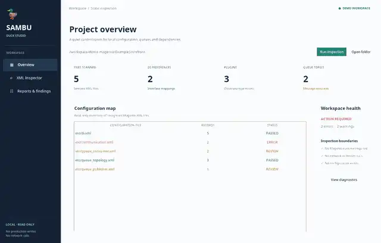
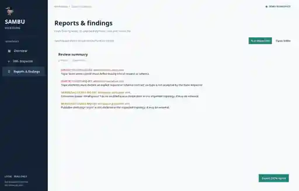
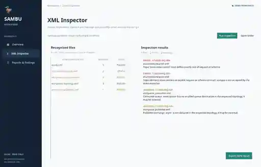

<p align="center"></p>
<h1 align="center">SAMBU</h1>
<p align="center"><strong>Scientific Modeling & Automation Environment</strong></p>
<p align="center"><strong>Экспериментальная alpha-версия</strong></p>
<p align="center"><a href="README.md">🇺🇦 Українська</a> · <a href="README.en.md">🇬🇧 English</a> · <a href="README.ru.md">🇷🇺 Русский</a></p>
<sub>Обновлено: 2026-11-11</sub>


## Навигация

- [Текущие возможности](#текущие-возможности)
- [Быстрый старт и проверка](#быстрый-старт-и-проверка)
- [Архитектура и подтверждённые границы](#архитектура-и-подтверждённые-границы)
- [Скриншоты Duck Studio](#скриншоты-duck-studio)
- [Инженерное качество](#инженерное-качество)
- [Карта документации](#карта-документации)
- [NUN Mesh и связанные репозитории](#nun-mesh-и-связанные-репозитории)
- [Дизайн и документация](#дизайн-и-документация)
- [Лицензия](#лицензия)

> **SAMBU** — SAMBU — экспериментальная среда на Python для программирования, научного моделирования и воспроизводимых рабочих процессов.

## Текущие возможности
- Языковое ядро: lexer/parser, AST, функции, области видимости, массивы и записи.
- Необязательные аннотации типов, постепенная статическая проверка через `sambu check` и контроль объявленных контрактов во время выполнения.
- Научный слой: величины SI, проверка размерностей, физические константы и воспроизводимая выборка.
- Пространственные данные: sparse voxel grids, чанки, Morton keys, octrees и графовые операции.
- CLI, Tkinter IDE, тестовый runner и частичный C11 native-compiler slice.

## Быстрый старт и проверка
```bash
python -m pip install -e .
python -m pytest
python one.py check
sambu check examples/typed_core.sambu
```

## Архитектура и подтверждённые границы
Native compiler slice пока не является полным конвейером source-to-machine-code. IDE не является полноценной LSP-системой. Экспериментальные функции нельзя описывать как готовые для production.

## Скриншоты Duck Studio

Эти изображения из репозитория показывают рабочее пространство приложения, отчёты и XML-инспектор.

<p align="center"></p>
<p align="center"><em>Duck Studio — главное рабочее пространство</em></p>

<p align="center"></p>
<p align="center"><em>Отчёты и результаты проверок</em></p>

<p align="center"></p>
<p align="center"><em>XML-инспектор</em></p>

## Инженерное качество
- Запускайте проверки для целевой платформы; host CI не заменяет аппаратную квалификацию.
- Статусы implemented, partial и planned должны подтверждаться кодом, тестами и доказательствами.
- Макет, спецификация или открытый Pull Request не доказывают production-ready реализацию.
- Внешние интеграции должны быть явными, версионированными, изолированными и тестируемыми.

## Карта документации

- [Duck Studio](docs/DUCK_STUDIO.md)
- [IDE и редактор](docs/IDE.md)
- [Архитектура native-компилятора](docs/NATIVE_COMPILER_ARCHITECTURE.md)
- [Архитектура экосистемы](docs/ECOSYSTEM_ARCHITECTURE.md)

## NUN Mesh и связанные репозитории

<p align="center"></p>
[SAMBU](https://github.com/bboroski/SAMBU) · [ToolNG](https://github.com/bboroski/ToolNG) · [ReaperCripple](https://github.com/bboroski/ReaperCripple) · [Kloz](https://github.com/bboroski/Kloz) · [CO](https://github.com/bboroski/CO) · [SaintSI](https://github.com/bboroski/SaintSI) · [Klipot](https://github.com/bboroski/Klipot) · [NUN](https://github.com/bboroski/NUN) · [NUNLauncher](https://github.com/bboroski/NUNLauncher)

Каждый репозиторий сохраняет каноническое имя, собственный код, API, цикл выпуска и границы ответственности. Интеграция означает версионированные контракты, а не автоматическое слияние независимых runtime.

## Дизайн и документация
Общее направление интерфейсов — **Duck Black / Yellow**: глубокий чёрный `#111111` для поверхностей и сигнальный жёлтый `#FFD600` для действий и состояний, читаемая типографика, доступный контраст, клавиатурная навигация и поддержка reduced motion. Подробности — в [design/DUCK_UI_SYSTEM.md](design/DUCK_UI_SYSTEM.md), если файл присутствует.

## Лицензия
MIT

---
**Создано с любовью к инженерии, системности и людям.**
