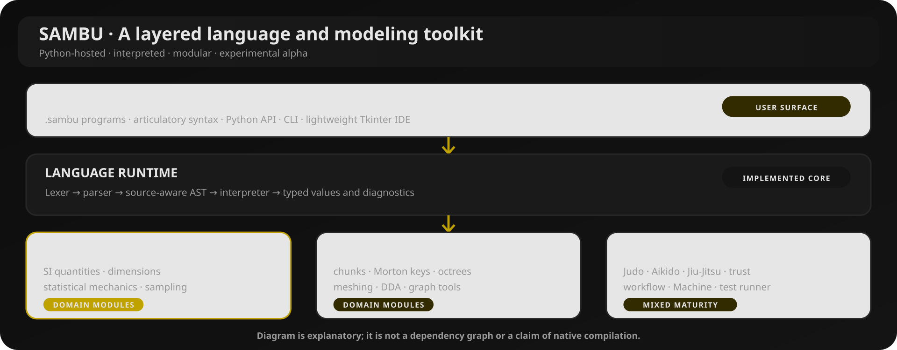
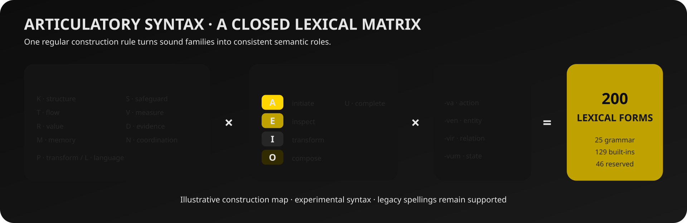
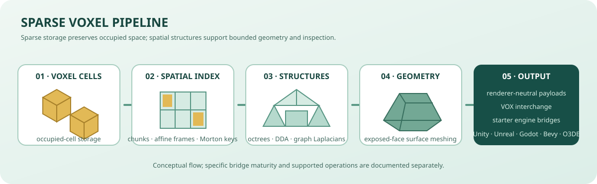

# SAMBU

### Statistical Analysis · Modeling · Systems · Trust

**Небольшой язык с широким горизонтом.**

Экспериментальный интерпретируемый язык и Python-инструментарий для научных вычислений, явного моделирования, системной архитектуры, рабочих процессов и разреженных voxel-миров.

[Українська](README.md) · [English](README.en.md) · [Русский](README.ru.md)

[Быстрый старт](#-быстрый-старт) · [Язык](#-язык-sambu) · [Возможности](#-карта-возможностей) · [Инструменты](#-инструменты-разработчика) · [Документация](#-документация)

---

> **Стадия зрелости: экспериментальная alpha.** Интерпретатор, отдельные предметные модули и CLI-инструменты реализованы и тестируются. Нативный компилятор, полная статическая система типов и эффектов, полноценная LSP-IDE и часть интеграций остаются задачами развития.

## Что такое SAMBU

SAMBU объединяет интерпретируемый язык для программ .sambu и Python-пакет для научных, архитектурных и workflow-задач. Инженерные приоритеты проекта — явные допущения, ограниченные операции, проверяемые результаты и модульная эволюция.

## Карта возможностей

| Направление | Возможности |
|---|---|
| **Ядро языка** | Lexer/parser, неизменяемый AST с source spans, области видимости, функции, ограниченные циклы, массивы, записи, классы и наследование. |
| **Научные вычисления** | SI-величины, проверка размерностей, физические константы, тепловая энергия, скорости Максвелла, факторы Больцмана, статистические суммы, энтропия и воспроизводимая выборка. |
| **Разреженные voxel-системы** | Ограниченные чанки, аффинные координатные системы, Morton keys, построение поверхностей, 3D DDA, sparse octrees, графовые лапласианы и обмен VOX. |
| **Инженерные модули** | Judo — графы архитектуры; Aikido — маршрутизация inference; Jiu-Jitsu — UI/MVC/RBAC-модели; workflow, проверки доверия и обратимые патчи. |
| **Экспериментальный runtime** | Ограниченные actor-mailbox, последовательная фиксация состояния, dead-letter записи, supervision и типизированные программные каналы. Это не нативное параллельное исполнение. |
| **Инструменты** | CLI sambu, read-only анализатор Magento XML sambu-studio, Tkinter IDE sambu-ide, sambu-test и SAMBU Machine. |
| **Анализ творческого текста** | Детерминированный разбор секций, припевов и компактных хуков, письменностей, приблизительной просодии, performance-cues и девятикластерной онтологии метаданных (2026.12). |

### Артикуляционный синтаксис

Вторая детерминированная поверхность синтаксиса строится по матрице: **10 семантических согласных семейств × 5 гласных градаций × 4 грамматических окончания = 200 форм**. Текущий словарь содержит 25 грамматических форм, 137 встроенных и 38 зарезервированных.

Это формальный синтаксический слой над parser, а не обработка естественного языка или генерация программ языковой моделью. Подробности — в [спецификации](docs/ARTICULATORY_SYNTAX.md).

### Конвейер sparse voxels

Стартовый bridge-код доступен для Unity, Unreal Engine, Godot, Bevy и Open 3D Engine. Наличие профиля или starter-кода не означает готовый или аппаратно проверенный плагин.

## Быстрый старт

**Требования:** Python 3.10+, Git. У интерпретатора нет обязательных сторонних runtime-зависимостей.

~~~bash
git clone https://github.com/bboroski/SAMBU.git
cd SAMBU
python -m pip install -e .
sambu --version
~~~

Создайте hello.sambu:

~~~sambu
let temperature = 300 * K
let particle_mass = 6.6e-26 * kg
let profile = maxwell(temperature, particle_mass)
print(profile.most_probable)
print(profile.mean)
print(profile.rms)
~~~

Запуск:

~~~bash
sambu hello.sambu
# или
sambu -c 'print("Hello from SAMBU")'
~~~

Примеры:

~~~bash
sambu examples/ideal_gas.sambu
sambu examples/boltzmann_weights.sambu
sambu examples/oop_and_games.sambu
sambu examples/voxel_world.sambu
sambu examples/supervised_runtime.sambu
~~~

## Язык SAMBU

Язык поддерживает объявления, выражения, пользовательские функции, условные конструкции, ограниченную итерацию, массивы, записи, доступ к полям и экспериментальную объектную модель.

~~~sambu
fn square(value) {
  return value * value
}
for number in range(1, 5) {
  print(square(number))
}
let distance = 12 * m
let duration = 3 * s
print(distance / duration)
~~~

Физические величины хранятся в нормализованной SI-форме. Сложение и сравнение требуют совместимых размерностей; умножение и деление комбинируют их показатели. Документированные циклы и range ограничены 100 000 элементами.

Пример артикуляционного синтаксиса:

~~~sambu
kava temperature = 300 * K
kava particle_mass = 6.6e-26 * kg
kava profile = vava(temperature, particle_mass)
lava(profile.rms)
~~~

## Инструменты разработчика

| Команда | Назначение |
|---|---|
| sambu | Запуск файлов и inline-кода; генерация каркасов проектов. |
| sambu-ide | Запуск лёгкой Tkinter IDE. |
| sambu-studio inspect PATH | Read-only анализ поддерживаемых Magento / Adobe Commerce XML. |
| sambu-test tests --repeat 2 | Повторные тесты и сводка вариативности. |
| sambu machine architecture | Проверка объявленных архитектурных слоёв. |
| sambu machine sample FILE --ratio 100 --seed 17 | Воспроизводимая выборка AST. |

IDE включает редактирование, открытие/сохранение файлов, запуск F5, вывод, диагностику и переключение RU/EN. Это пока не LSP-клиент. Machine поддерживает архитектурную проверку и детерминированную выборку, но не полный статический анализ типов/эффектов и не нативную компиляцию.

Необязательные host-адаптеры:

~~~bash
python -m pip install -e ".[flask]"
python -m pip install -e ".[django]"
python -m pip install -e ".[fastapi]"
~~~

Аутентификация, транспортная безопасность, хранение данных и авторизация остаются ответственностью host-приложения.

## Анализ текста и семантические метаданные

Text Craft предоставляет детерминированные описательные сигналы для анализа текста:

- заголовки секций и точные повторы блоков;
- видимое смешение латиницы, кириллицы и других письменностей;
- приблизительные подсчёты слогов, орфографические группы рифм, внутренние созвучия и аллитерацию;
- явные письменные маркеры: сценические ремарки, скобочные примечания, цитаты и дефисные повторы.

Все демонстрационные данные SAMBU — нейтральные синтетические fixtures: сообщения сервиса, состояния интерфейса, каталожные записи и технические описания. Они не взяты из пользовательских стихов, песен или личных исходных текстов.

`hook_profile(text)` проверяет компактную структуру из 2–4 непустых строк, повторы, приблизительные рифмы и разброс слогов. Он не предсказывает реакцию аудитории. `performance_cues_profile(text)` извлекает письменные маркеры и их позиции, но не определяет эмоции, личность говорящего или фактическую манеру исполнения.

Онтология metadata имеет версию **2026.12** и содержит девять кластеров с человеческой аннотацией (T-001…T-009). Валидатор проверяет переданные метаданные, но не классифицирует неаннотированный текст, не создаёт embeddings и не дообучает модель.

~~~bash
sambu creative clusters --json
sambu creative validate examples/creative_metadata_examples.sample.json --json
sambu examples/performance_cues.sambu
~~~

См. [Text Craft](docs/text_craft.md), [Hook Craft и модели открытых систем](docs/OPEN_SYSTEM_AND_HOOK_CRAFT.md) и [Creative Data Governance](docs/CREATIVE_DATA_GOVERNANCE.md).
## Инженерная доктрина

Пять принципов SAMBU:

- **Safety** — явные полномочия, границы доступа и доверия.
- **Adaptive exploration** — воспроизводимые эксперименты на основе гипотез.
- **Managed recovery** — ограничение памяти, очередей, объёма работы и повторов.
- **Branchable design** — модульные слои и явные контракты.
- **Unforced interoperability** — стабильные интерфейсы и свобода пользователя.

Machine добавляет capability-профили, детерминированную выборку AST 1:100 и ограниченный Ghost Ledger. Sealed предназначен для инспекции; sandbox разрешает выполнение в интерпретаторе SAMBU. Ни один профиль не является OS sandbox. Host и device резервируют будущие адаптеры и не предоставляют фактический доступ к shell, сети или оборудованию.

## Проверка качества

~~~bash
python -m unittest discover -s tests -v
sambu-test tests --repeat 2
sambu-test tests --repeat 2 --json
~~~

В репозитории также есть сценарии воспроизводимых voxel-бенчмарков. Сравнивать производительность следует только на одинаковой нагрузке и конфигурации сборки.

## Статус и дорожная карта

**Реализовано:** ядро интерпретатора, Python-модули предметных областей, научные функции, sparse voxel-операции, отдельные actor/channel-примитивы, CLI, Machine inspection, IDE-сервисы и Tkinter-редактор.

**Развивается:** статический анализ, семантика ownership/effects, интеграция IDE, этапы нативного toolchain и host/device-адаптеры.

**Не заявляется как готовое:** нативный компилятор, self-hosting, совместимость с C++ ABI, полная совместимость с Pascal/Delphi/Fortran, production web-framework, автоматическое развёртывание, OS sandbox или полноценная LSP IDE.

## Документация

- [Артикуляционный синтаксис](docs/ARTICULATORY_SYNTAX.md) · [Инженерная доктрина](docs/SAMBU_ENGINEERING_DOCTRINE.md)
- [Системная архитектура](docs/CRIPPLE_SYSTEMS_ARCHITECTURE.md) · [Voxel reference](docs/VOXELS.md)
- [Creative Data Governance](docs/CREATIVE_DATA_GOVERNANCE.md) · [Studio Guide](docs/DUCK_STUDIO.md)
- [Исходный код и тесты](https://github.com/bboroski/SAMBU/tree/main) · [Issues](https://github.com/bboroski/SAMBU/issues)

## Участие и лицензия

Приветствуются целевые pull request с воспроизводимым примером, ожидаемым/фактическим поведением, тестами и описанием допущений. MIT — см. [LICENSE](LICENSE).

**SAMBU — моделируй ясно. Сочетай осмысленно. Проверяй честно.** 🦆

## Интеграция в NUN Mesh

SAMBU — языковой и инструментальный слой. Tkinter IDE и Duck Studio остаются отдельными приложениями; ToolNG встраивает только переносимое ядро policy/workflow, а не Python-интерпретатор. [Руководство интеграции](docs/ECOSYSTEM_INTEGRATION.md) · [Портал Klipot](https://github.com/bboroski/Klipot) · [Общий протокол](https://github.com/bboroski/Klipot/blob/main/docs/INTEGRATION_PROTOCOL.md)
