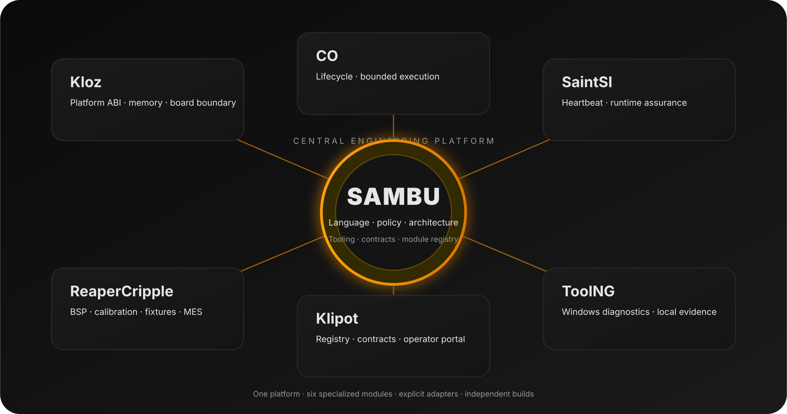
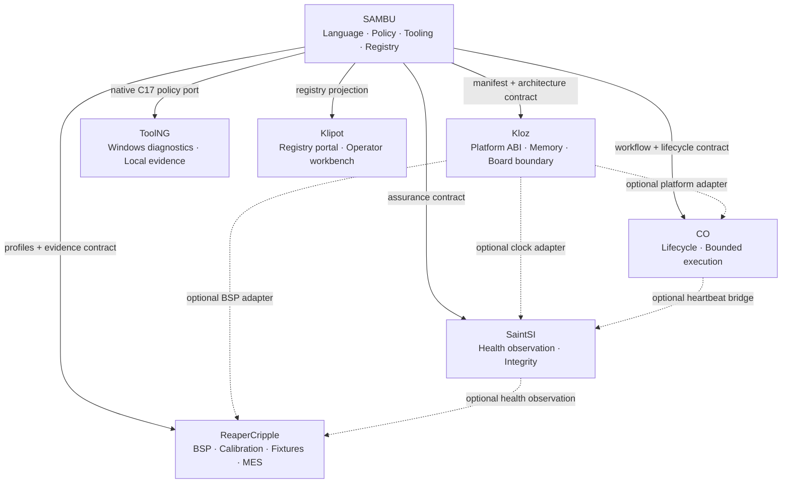

# SAMBU Ecosystem Architecture

**Status:** repository integration baseline, 2026-11-10  
**Canonical registry:** [`ecosystem/registry.json`](../ecosystem/registry.json)  
**Manifest contract:** [`ecosystem/module.schema.json`](../ecosystem/module.schema.json)

## 1. Purpose

SAMBU is the umbrella engineering platform for nine coordinated repositories: seven implemented engineering projects and two specification-only system projects, NUN and NUNLauncher. It owns the ecosystem-level language, developer tooling, architectural models, module-manifest contract and canonical registry. The repositories below are specialized modules of one ecosystem, not directories to be collapsed into one source tree.

The former **NUN Mesh** label is superseded as the ecosystem's public architecture name by **SAMBU Ecosystem**. Existing historical filenames and illustrations may retain the older wording until they are deliberately refreshed; that legacy wording does not define a runtime dependency.

## 2. System map

Solid lines are ecosystem-level contracts or an existing policy port. Dashed lines are optional native adapters; they must not be interpreted as mandatory link dependencies.

## 3. Module ownership

| Module | Responsibility owned by the repository | Runtime / implementation | Boundary |
|---|---|---|---|
| **SAMBU** | Language, engineering doctrine, developer tools, workflow descriptions, module schema and registry | Python 3.10+, experimental language runtime | Not an OS, native compiler, universal sandbox or automatic executor of external operations |
| **Kloz** | Fixed-width status ABI, caller-owned memory, versioned platform operations | Freestanding-oriented C11 | Board/CPU port owns MMIO ordering, interrupts, DMA/cache and reset semantics |
| **CO** | Deterministic component lifecycle, bounded polling, fault retention and cleanup | Allocation-free C11 | Not an RTOS, thread scheduler or MMIO driver |
| **SaintSI** | Fixed-capacity heartbeat registry, timeout observation and CRC-32 | Allocation-free C11 | Observer only; CRC-32 is not cryptographic and heartbeat is not proof of correctness |
| **ReaperCripple** | BSP integration, staged bootstrap, pinout governance, production profiles, calibration, fixture recipes and MES events | C11 / CMake / target-specific toolchains | Host tests do not qualify a board, pinout, electrical limit, calibration or production profile |
| **ToolNG** | Windows-side Apple USB observation, local reports and evidence quality gates | C17 / Win32 | Native application; it ports selected SAMBU policy rules and does not embed Python or execute `.sambu` programs |
| **Klipot** | Registry discovery, dependency presentation, contract catalog and operator-facing browser labs | Static HTML/CSS/JavaScript | Browser labs are simulations, not firmware execution, live telemetry or hardware evidence |
| **NUN** | Minimal kernel architecture, boot handoff, memory, execution and protection contracts | Specification-only; target runtime not implemented | No bootable image, linker script, driver set or target support is claimed |
| **NUNLauncher** | Kernel-image validation and versioned boot-information handoff | Specification-only; bootloader not implemented | No automatic flashing, unverified image handoff or hidden fallback is allowed |

## 4. Dependency and execution rules

1. **SAMBU is the architecture and tooling authority, not a hidden runtime dependency.** Embedded C libraries remain buildable without Python, SAMBU, or Klipot.
2. **Kloz is the lowest shared software boundary.** It provides explicit platform services to applications through versioned operations; higher layers do not reach directly into CPU-specific registers.
3. **CO owns lifecycle transitions.** Its caller supplies callbacks and serializes access from independent execution contexts.
4. **SaintSI observes progress.** A stale heartbeat or degraded result is input to an application policy, not permission to reset hardware or feed a watchdog.
5. **ReaperCripple composes target-specific services.** It validates the exact MCU/SoC, package, board and schematic revision, fixture, calibration set and approved profile.
6. **ToolNG remains a native Windows application.** Its SAMBU relationship is a reviewed native C17 port of selected policy and workflow rules, not a dependency on the Python package.
7. **Klipot is a presentation/control plane.** It consumes a registry projection, but no embedded target links or trusts the portal to perform hardware actions.
8. **NUNLauncher owns the system-entry boundary.** It validates image metadata, memory ranges, signature state and the versioned handoff before transfer; it does not duplicate kernel services.
9. **NUN owns the kernel boundary.** It independently validates boot context and owns architecture entry, memory, execution, protection and device interfaces. Both system repositories are currently specifications only.

No module receives filesystem, process, network, device or actuator authority merely because it appears in the registry. Every privileged operation requires an implemented adapter, explicit capability, caller authorization and independent evidence.

## 5. Cross-repository contract

Every repository publishes a root `sambu.module.json` conforming to the shared schema. A manifest describes:

- stable module ID, repository and role;
- runtime and maturity;
- provided and consumed capabilities;
- required or optional adapter relationships;
- safety and ownership boundaries;
- validation evidence and target-specific qualification status.

The canonical ecosystem registry is maintained in SAMBU at `ecosystem/registry.json`. Klipot's `registry/ecosystem.json` is its portal-facing projection. Keep the two registries semantically aligned when module roles or contract versions change.

### Compatibility rules

- A manifest schema breaking change increments its major version.
- Native C interfaces use fixed-width fields, explicit structure size/version and caller-owned buffers.
- Never serialize a native C structure by copying its memory; transport encoding must define byte order and field widths.
- Convert clock units explicitly and document rollover limits.
- Keep adapters outside portable cores.
- Mark hardware support only after target-specific cross-compilation and hardware-in-the-loop evidence.
- Separate **implemented**, **adapter-ready**, **planned**, **simulated**, **unknown** and **not tested** states.

## 6. Integration maturity

| Connection | State | Interpretation |
|---|---|---|
| SAMBU → all modules | Contract defined | The manifests and ownership rules exist; this is not a universal plugin loader |
| SAMBU → ToolNG | Existing native policy port | Selected rules are implemented in C17; there is no Python runtime linkage |
| SAMBU → Klipot | Registry mirrored | The portal reflects the ecosystem registry; automated synchronization is not claimed |
| Kloz → CO | Adapter-ready | The application may pass platform services through callback context |
| Kloz → SaintSI | Adapter-ready | Optional clock bridge; caller owns tick semantics |
| Kloz → ReaperCripple | Adapter-ready | Target BSP and measurement callbacks remain board-specific |
| CO → SaintSI | Adapter-ready | Heartbeat bridge is refreshed only after successful polling |
| SaintSI → ReaperCripple | Adapter-ready | Health is observed; recovery and actuation remain application/board policy |
| NUNLauncher → NUN | Planned | Versioned kernel image and boot-information handoff; neither implementation exists yet |
| Kloz → NUN | Planned optional adapter | A future kernel port may adapt platform capabilities without making Kloz mandatory |

## 7. Local validation

Run checks in each repository using its own toolchain:

| Repository | Baseline command |
|---|---|
| SAMBU | `python -m unittest discover -s tests -v` |
| Kloz | `make test` |
| CO | `make test` |
| SaintSI | `make test` |
| ReaperCripple | `cmake -S . -B build -DREAPER_BUILD_TESTS=ON && cmake --build build --parallel && ctest --test-dir build --output-on-failure` |
| ToolNG | `cmake -S . -B build -A x64 -DBUILD_TESTING=ON` then build and CTest on Windows |
| Klipot | Open `index.html` locally and run the Pages/asset validation workflow |
| NUN | Specification/manifest validation only; no kernel build exists yet |
| NUNLauncher | Specification/manifest validation only; no bootloader build exists yet |

These are documented repository commands, not a claim that they were executed during this registry change. Hardware qualification remains a separate gate.

## 8. Layered autonomy and update lifecycle

Each repository owns its source, build, API, tests, configuration, release cadence and rollback. Integration is performed by declared contract versions and explicit adapters; required dependencies must be minimal, optional adapters must fail independently, and cyclic required dependencies are rejected. Klipot is a control plane only and is never a firmware or kernel runtime dependency.

Dependabot checks GitHub Actions weekly in all repositories and Python package dependencies in SAMBU. Updates arrive as pull requests, pass repository contract CI, and are reviewed before merge. Automatic merge and automatic installation are disabled. This provides automatic dependency-update proposals, not a claim that every product already has an in-app updater or published release artifacts.

Application and desktop releases may use versioned GitHub Releases when artifacts are published. Installers must validate provenance, integrity/signature, platform and contract compatibility, preserve the last known-good release, and provide a rollback path. Kernel, bootloader and firmware updates additionally require target-specific recovery evidence and explicit operator approval; no unattended flashing or boot-chain replacement is allowed.

Scheduled ecosystem-guard workflows validate manifests and update policy. Repositories with executable one-knob checks run their local checks; NUN and NUNLauncher remain explicitly specification-only until code and target evidence exist.

## 9. Evolution path

1. Validate every `sambu.module.json` against the shared schema in CI.
2. Add a SAMBU CLI command that reads manifests, detects missing modules, duplicate capability providers and dependency cycles without executing module code.
3. Generate the Klipot registry projection and dependency graph from the canonical SAMBU registry.
4. Add versioned adapter conformance tests for Kloz/CO/SaintSI/ReaperCripple.
5. Define explicit evidence exchange for ToolNG and ReaperCripple without exporting private device or production data by default.
6. Only after those contracts are stable, consider a supervised host-side module runner. It must not be described as OS sandboxing or native embedded orchestration.

**Design rule:** one ecosystem, nine repository owners, explicit contracts, independent builds, safe update proposals, evidence before claims.
