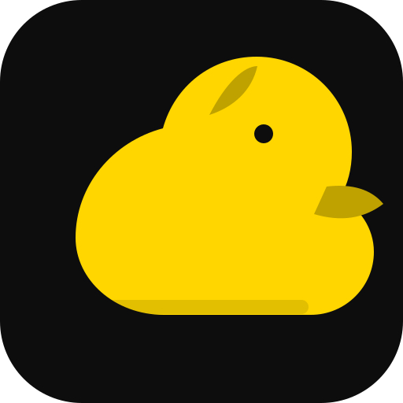

<strong>SAMBU · PROJECT ENCYCLOPEDIA</strong>

<em>Architecture, language reference, and project governance</em>

<a href="../README.md">Project overview</a> · <a href="../README.en.md">English overview</a> · <a href="../README.ru.md">Russian overview</a>

# SAMBU Wiki — Project Encyclopedia

> **SAMBU: model clearly. compose carefully. verify honestly.**

Welcome to the project encyclopedia for SAMBU: an experimental interpreted programming language and modeling toolkit. This wiki explains the language, its runtime, libraries, architecture frameworks, scientific models, voxel systems, developer tools, security boundaries and current development status.

- **Project:** [bboroski/SAMBU](https://github.com/bboroski/SAMBU)
- **Current repository release label:** 0.11.0-alpha
- **Implementation language:** Python 3.10+
- **License:** MIT
- **Status:** experimental alpha; APIs and capabilities may change.

## Start here

| Page | What it covers |
|---|---|
| [About SAMBU](ABOUT.md) | Identity, purpose, scope and design principles |
| [Getting started](GETTING-STARTED.md) | Installation, commands and first program |
| [Language tour](LANGUAGE-TOUR.md) | How a SAMBU program is tokenized, parsed and executed |
| [Syntax and control flow](SYNTAX-AND-CONTROL-FLOW.md) | Expressions, functions, scopes, conditions and loops |
| [Types, units and numerics](TYPES-UNITS-AND-NUMERICS.md) | Runtime values, physical dimensions and numeric rules |
| [Object-oriented programming](OBJECT-ORIENTED-PROGRAMMING.md) | Classes, inheritance, interfaces, traits and games |
| [Scientific computing](SCIENTIFIC-COMPUTING.md) | Units, constants, statistical mechanics and distributions |
| [Domain libraries](DOMAIN-LIBRARIES.md) | Percentages, Anatidae, strategy, production and workflow models |
| [Frameworks](FRAMEWORKS.md) | Judo, Aikido and Jiu-Jitsu |
| [Voxel systems](VOXELS-AND-ENGINE-ADAPTERS.md) | Sparse grids, meshing, spectral graphs and engine bridges |
| [Trust and evidence](TRUST-AND-EVIDENCE.md) | Integrity checks, issuer allow-lists and evidence records |
| [Workflows and chunking](WORKFLOWS-AND-CHUNKING.md) | Bounded batches, reversible patches and deterministic plans |
| [Studio and inspection](STUDIO-AND-INSPECTION.md) | CLI tooling, project inspection and the IDE roadmap |
| [Integrations and security](INTEGRATIONS-AND-SECURITY.md) | Framework adapters and host-application responsibilities |
| [Testing and diagnostics](TESTING-AND-DIAGNOSTICS.md) | Unit tests, repeat runs, diagnostics and CI |
| [Design philosophy and roadmap](DESIGN-PHILOSOPHY-AND-ROADMAP.md) | Implemented principles, proposed evolution and release discipline |
| [Glossary](GLOSSARY.md) | Core terms and subsystem names |
| [Contributing](CONTRIBUTING.md) | How to report, test and propose changes |

## How to read this wiki

This encyclopedia distinguishes three kinds of statements:

- **Implemented** — described by the current repository README, source code or runnable examples.
- **Limited** — implemented for a bounded purpose; the boundary is stated explicitly.
- **Planned** — a roadmap direction, proposal or design goal, not a claim about current software.

A model that calculates a plan is not automatically an integration that executes the plan. A source inspector is not a full compiler or official validator. A hash comparison is not identity verification. Read each page's limitations before relying on a result.

## Source of truth

The repository's current source code, tests, examples and package metadata take precedence over older explanatory material. Some historical documents describe earlier release targets; consult [Design philosophy and roadmap](DESIGN-PHILOSOPHY-AND-ROADMAP.md) for the documentation policy and version caveats.

For installation and runnable examples, begin with the root [README](../README.md). For implementation details, inspect the relevant module under `sambu/`, `sambu_studio/`, `tests/` or `examples/`.

---

*This is the SAMBU project's own technical encyclopedia. It is not an article hosted by Wikipedia and does not claim independent encyclopedic notability.*

## Engineering doctrine and developer control plane

The expanded engineering model is documented in [SAMBU Engineering Doctrine](../docs/SAMBU_ENGINEERING_DOCTRINE.md). It defines the five-letter code (Safety, Adaptive exploration, Managed recovery, Branchable design, Unforced interoperability), Plywood design, 1:100 code sampling, the 10,000-entry failure-signature ledger, Effort Amplification, SAMBU Machine and the headless SAMBU IDE.
